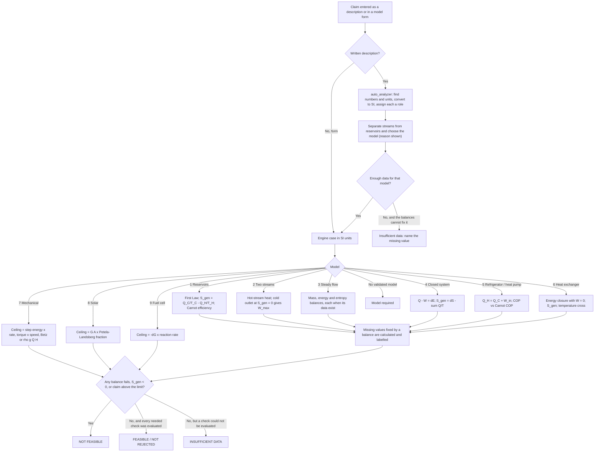

# How the tester reaches a verdict

GitHub renders the diagram below. Any Mermaid viewer also works.

A few notes on the less obvious paths:

- When a calculated value closes the First Law (for example the rejected heat Q_C = Q_H - W), the energy balance passes
  by construction. The result marks that value as calculated, not given.
- If a Model 2 claim gives no work, the answer is the limit W_max on its own ("LIMIT CALCULATED").
- Property questions, such as the enthalpy change of heating water, go to the property calculator. They get numbers but
  no verdict, because no device is being judged.
- A claim exactly at the limit (S_gen = 0 within tolerance) is accepted as the reversible case.
